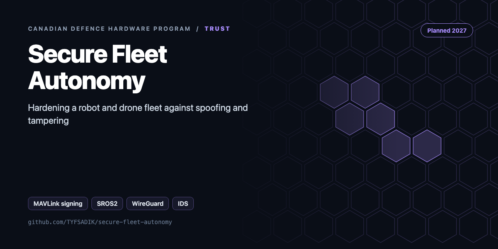
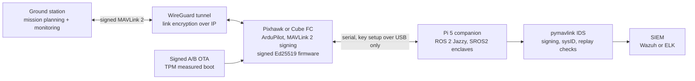

<div align="center">



# Secure Autonomy for the Robot and Drone Fleet

**Hardening guide for a robot and drone fleet: MAVLink 2 signing, signed Ed25519 firmware, SROS2 enclaves, WireGuard links, IDS alerts, and tamper-proof OTA.**

[](https://github.com/TYFSADIK/secure-fleet-autonomy/actions/workflows/tests.yml)   [](LICENSE) [](https://github.com/TYFSADIK/defence-hardware-program)

[Build guide](docs/project-page.md) · [How it works](#how-it-works) · [Quick start](#quick-start) · [Program hub](https://github.com/TYFSADIK/defence-hardware-program)

</div>

## Overview

This is a build guide for hardening a small fleet of ArduPilot drones and ROS 2 ground robots against takeover, spoofed commands, malicious firmware, and untracked change. It starts from a STRIDE threat model across every trust boundary, then applies six controls: MAVLink 2 packet signing, WireGuard link encryption, Ed25519 signed firmware, SROS2 least-privilege enclaves, a pymavlink intrusion detector feeding a SIEM, and signed A/B over-the-air updates. Every control is attacked in the lab before it is trusted.

**Status: Planned.** This page is a published build guide written against the Defence Drone Initiative's digital-enablers stream, which covers communications, cyber, and command and control for autonomous platforms (verify). Nothing on this page is built, attacked, or measured yet. Each control below is defined together with the test case that will prove or break it, and results will appear here only after the lab work runs.

Why this build exists: a security operations background is the differentiator. Most hobby fleets ship with open telemetry links, unsigned firmware, a flat ROS 2 network where any node can publish to any topic, and no logging at all. The professional version of this work is to attack your own fleet in the lab, fix what breaks, and monitor what remains. That cycle, threat model, control, attack, evidence, is the deliverable, not any single tool.

## How it works



*Every trust boundary carries a named control. The GCS link is encrypted by WireGuard and authenticated by MAVLink 2 signing; firmware and updates are signed; the ROS 2 graph is partitioned by SROS2 enclaves; and a protocol-aware IDS watches the traffic that remains, alerting into a SIEM.*

## Quick start

```bash
pip install -r requirements.txt
python demo.py && python -m unittest -v
```

Real output from the demo, run on simulated data:

```text
signed heartbeat: (True, 'ok')
same frame again: (False, 'replay')
unsigned: (False, 'unsigned')
wrong key: (False, 'bad-signature')
IDS: {'t': 0, 'sysid': 7, 'rule': 'mavlink-unsigned', 'severity': 'high'}
IDS: {'t': 0, 'sysid': 7, 'rule': 'unknown-sysid', 'severity': 'high'}
IDS: {'t': 0, 'sysid': 7, 'rule': 'command-from-non-gcs', 'severity': 'high', 'cmd': 'COMMAND_LONG'}
IDS: {'t': 2, 'sysid': 1, 'rule': 'gnss-jump-possible-spoof', 'severity': 'high', 'implied_ms': 1111.9}
IDS: {'t': 3, 'sysid': 255, 'rule': 'safety-param-change', 'severity': 'high', 'param': 'ARMING_CHECK'}
firmware ok: 1024 bytes
    <enclave path="/rover1/nav">
```

## What's in this repo

| Path | Phase | Purpose |
|---|---|---|
| `threat-model/STRIDE.md` | 0 | Assets, threats, controls, and the test that proves each control |
| `fleetsec/mavlink2.py` | 1 | MAVLink 2 framing, X.25 CRC, **message signing and verification from the spec**, per-stream replay protection, stale-stream check |
| `fleetsec/firmware.py` | 3 | Signed firmware container: Ed25519, board lock, **anti-downgrade**, digest |
| `fleetsec/sros2.py` | 4 | Generates SROS2 least-privilege policy XML per enclave |
| `fleetsec/ids.py` | 5 | Rule IDS: signature failures, unknown sysid, commands from non-GCS, command flood, safety-param changes, GNSS jump (spoofing) |

## What you need

- **Spare Pixhawk or Cube flight controller**: the signed-bootloader practice board, because a wrongly signed board loops in the secure bootloader and that lesson should happen on a spare.
- **Pi 5 companion computer**: carries the WireGuard endpoint, the ROS 2 nodes, and the pymavlink IDS.
- **Two hardware security keys**: one in use, one backup, for key custody and signing operations.
- **Managed switch with VLANs**: the isolated lab network boundary that makes attack testing legitimate and contained.

## Spec gaps

How the hobby build compares with the requirement it is built against:

| Control | Test case | Status |
|----|----|----|
| MAVLink 2 signing | Unsigned and wrongly signed rejected; correctly signed accepted; replays rejected | Planned, not tested |
| MAVLink 1 / unsigned policy | Reject-by-policy verified on every link | Planned, not tested |
| WireGuard link encryption | Telemetry confidential on the IP path; serial-radio limits documented | Planned, not tested |
| Signed firmware (Ed25519) | Tampered image refused at boot; signed image accepted; key-removal behaviour documented | Planned, spare board first |
| USB / DFU lockdown | USB bypass of MAVLink signing closed or documented as residual risk | Planned, not tested |
| SROS2 enclaves | Cross-enclave publish/subscribe blocked; CPU and latency overhead measured both ways | Planned, not tested |
| pymavlink IDS | Each alert class fires on its injected attack; no false silence | Planned, not tested |
| SIEM pipeline | Alerts reach Wazuh or ELK and are readable by a human | Planned, not tested |
| Signed A/B OTA | Tampered update rejected; rollback path verified | Planned, reuses secure-fleet-updates design |
| Parser fuzzing | AFL++/libFuzzer runs against MAVLink parsers, crashes triaged | Planned, not tested |
| Operational fleet security | Out of scope: bench fleet on an isolated network only | Not claimed |

## What gets measured

- Test-case pass/fail table with evidence: one row per threat, one artefact per row (pcap, log excerpt, or console capture).
- Signing acceptance and rejection counts: unsigned, wrongly signed, correctly signed, replayed.
- SROS2 overhead: CPU and end-to-end latency with and without enclave enforcement.
- WireGuard overhead on the telemetry path, measured the same way.
- IDS alert latency: injected attack to SIEM-visible alert, in seconds.
- IDS coverage: alert classes tested versus alert classes defined, with misses named.
- Fuzzing results: crashes found, crashes fixed, parser coverage notes.
- Key-handling audit: proof that no signing key appears in any log or telemetry capture.

## Status

- **Now to December:** this build and the counter-drone scoring harness come first in the program calendar because they are software and simulation work; the southern Ontario winter is no obstacle when the fleet under attack is SITL instances on a lab VLAN.
- **Week 1:** publish the STRIDE threat model, data-flow diagram, asset list, and the threat-to-test-case table.
- **December to March:** run Phases 1-7 indoors; the cold-weather hardware builds (Arctic drone bench work, snow navigation) run in parallel, and their vehicles join this fleet as signed-firmware test subjects once they exist.
- **Evidence publication:** the test-case table with pass/fail artefacts and the hardening checklist land here as each phase completes, replacing the Planned rows in the gap table.
- **Program fit:** the evidence pack is written so it maps onto the digital-enablers language of the MINERVA challenges run through Innovative Solutions Canada and the IDEaS program's counter-drone work, where cyber-resilient C2 for autonomous platforms is a stated interest.

## Roadmap

- [ ] Phase 1: enable signing on ArduPilot (`SETUP_SIGNING` from MAVProxy: `signing setup <passphrase>`) and run `SignatureVerifier` on a MAVLink router tap. Check `CRC_EXTRA` against pymavlink for every message you use
- [ ] Phase 2: WireGuard between GCS and companion computers over the IP radios
- [ ] Phase 4: `ros2 security create_enclave` per node, `ROS_SECURITY_STRATEGY=Enforce`, and confirm that telemetry → `cmd_vel` is denied
- [ ] Phase 5: Zeek or Suricata on the GCS network, plus this IDS on the decoded MAVLink stream, with alerts sent to `decision-black-box`
- [ ] Phase 7: red-team your own SITL fleet (replay, unsigned injection, GNSS jump) and record detection time for each test

## Related builds

- [**Secure Fleet Updates**](https://github.com/TYFSADIK/secure-fleet-updates), the signed A/B OTA and TPM measured-boot design this build reuses for update integrity.
- [**Decision Black Box**](https://github.com/TYFSADIK/decision-black-box), the tamper-evident logging sibling: security alerts and evidence rows belong in the same append-only discipline.
- [**Thermal Search-and-Rescue Drone**](https://github.com/TYFSADIK/thermal-sar-drone), the X500-class quad that becomes the first signed-firmware test vehicle in this fleet.
- [**GPS-Denied Navigation Rover**](https://github.com/TYFSADIK/gps-denied-navigation-rover), the ground vehicle side of the fleet, sharing the ROS 2 network this guide partitions with SROS2.
- [**Canadian Defence Hardware Program**](https://github.com/TYFSADIK/defence-hardware-program), the hub page: how this build fits the Defence Drone Initiative digital-enablers stream and the rest of the bench.

## Safety and legal

**Defensive only:** this build detects, authenticates, encrypts, and monitors. Nothing here jams, spoofs, or carries munitions. RF work is receive-only, and GNSS work is detection only.

**Attack only your own gear:** every injection, replay, and fuzzing run targets SITL instances or project-owned hardware on an isolated network, with permission. The managed-switch VLAN is a hard boundary, not a suggestion.

**Key custody:** the MAVLink signing key travels only in SETUP_SIGNING over a secure link such as USB; logs and telemetry captures must never record it. The firmware private key stays offline. Losing either key silently turns the controls into decoration.

**Firmware practice discipline:** signed-bootloader experiments happen on the spare board first; forum reports describe wrongly signed boards looping in the secure bootloader, and USB paths that bypass signing, so DFU lockdown is tested, not assumed.

## Learn more

The full build guide, with step-by-step instructions, wiring, troubleshooting and lessons learned, is in [docs/project-page.md](docs/project-page.md). It is also published at [tyfsadik.org](https://tyfsadik.org/work/defence/secure-fleet-autonomy.html).

## License

[MIT](LICENSE). Built by [Taki Sadik](https://tyfsadik.org) as part of the self-funded [Canadian Defence Hardware Program](https://github.com/TYFSADIK/defence-hardware-program).
